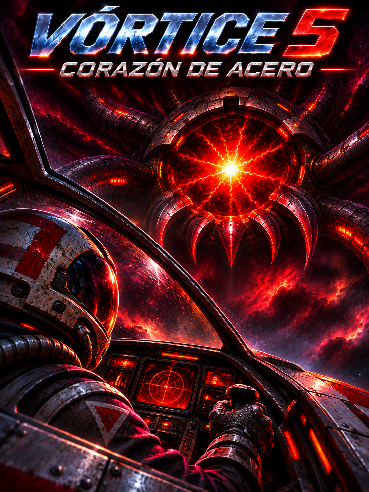

# VÓRTICE 5 — CORAZÓN DE ACERO

**Diseño V2: El Star Force Europeo**  
Shoot 'em up vertical para **Atari 400 / 800 / XL / XE**, 48 KB, NTSC.

> Una idea de hace décadas, por fin ve la luz de la manera más sorprendente, en la máquina que nadie esperaba.

**© 2026 Tony C. Ware**

## La historia

**El Ordenador Estelar se ha vuelto loco.** Leviatán V y sus fuerzas robotizadas amenazan la paz del universo. Solo el Vórtice 5 podrá abrirse paso hasta el Corazón de Acero. Y el piloto… **ES USTED.**

[Leer la historia oficial](HISTORIA.md).

## Descargas

La [Release V1.0](../../releases/tag/v1.0) reúne los tres formatos:

| Archivo | Descripción |
|---|---|
| `vortice5.xex` | Ejecutable Atari 8-bit |
| `vortice5.atr` | Disco autoarrancable |
| `vortice5.car` | Cartucho AtariMax 128 KB, tipo 41 |
| `VORTICE5_FINAL.zip` | Proyecto completo, código y material de producción |

Los formatos están diseñados para 48 KB y NTSC; en PAL funcionan más lentamente.

## Cinco sectores y cinco jefes

1. **Cementerio de Titanes** — GARRA-9.
2. **Arrecife de Ácido** — MADRE PÓLIPO.
3. **Fundición Orbital** — HORNO OMEGA.
4. **Santuario Prisma** — EL PRISMARCA.
5. **Corazón de Acero** — LEVIATÁN V.

## Controles y reglas

- Joystick en puerto 1; FIRE dispara (mantenerlo activa el disparo continuo).
- En el título: izquierda/derecha o SELECT para elegir Fácil, Normal o Hardcore; FIRE o START comienza.
- **Fácil:** 5 vidas. **Normal:** 3 vidas. **Hardcore:** 2 vidas.
- Cápsulas **P**: mejoran el disparo hasta el nivel III; al morir vuelve al nivel I.
- Vida extra a los 20.000 puntos y cada 50.000 posteriores.
- Los enemigos aéreos y los objetivos de suelo pueden destruirse con el disparo de la nave.

## Contenido del proyecto

- [Libro del juego (37 páginas)](documentos/VORTICE_5_Libro_del_juego.pdf): diseño, instrucciones, atlas y arte.
- [Código fuente 6502](codigo_fuente/): ensamblador, gráficos y generadores. `build.sh` recompila XEX, ATR y CAR con cc65, Python 3 y Pillow.
- [Banco de trabajo](banco_de_trabajo/): análisis de rendimiento, herramientas y guía.
- [Banda sonora](banda_sonora/): cuatro temas grabados del emulador.
- [Historia oficial](HISTORIA.md).

## Integridad de las ROM de esta versión

| Formato | SHA-256 |
|---|---|
| XEX | `7fa09177294f9fa2b643a8a828acc4e06ce57ca51eda59cf1f8082451b7b9fad` |
| ATR | `b59186d198ff185850ac31f4879b9c7fb3ed608f30e2b26604a034ddbc3039b5` |
| CAR | `880814e0f6867bc0e313c189c83a5de0d02abb8a57d8adf20c670e4e94195e74` |

## Créditos

Diseño, nombres, fases, gráficos y música: **Tony C. Ware**, 2026. Adaptación a los límites de la máquina con asistencia de IA.

Proyecto independiente y no oficial. Atari es una marca de sus respectivos titulares. Consulta la licencia del repositorio y los derechos aplicables a recursos artísticos y musicales.
